<p align="center">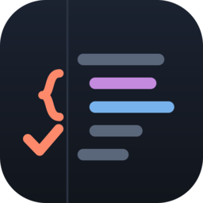</p>

# Margin

An iPad remote for Claude Code, built around the Apple Pencil.

Claude Code keeps working on your own computers; Margin brings you what needs
you. Read what Claude did, draw on it, and send it back: a chat message, a
plan, a diff, a render, a web page it's running. Every stroke goes back with
what it landed on, in words ("circled `one to many (custom)`", "on the added
line `if p.Index < 0`"), so Claude can act on it.

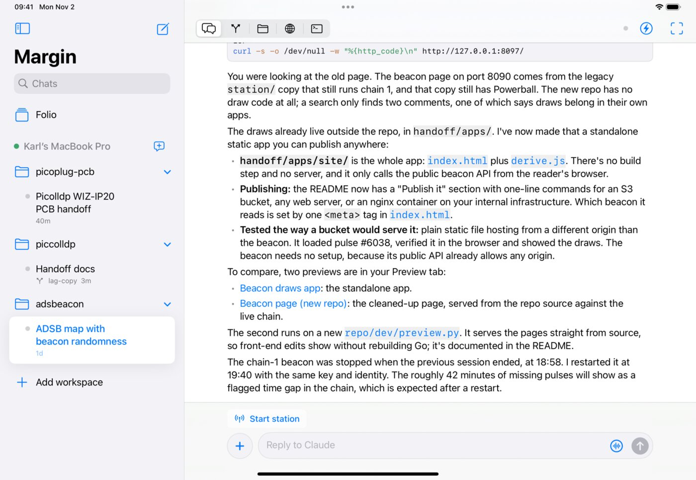

- **Chats are normal Claude Code sessions.** Anything started from the iPad
  shows up in `claude --resume` at the desk and the other way round, with the
  same CLAUDE.md, memory, settings, MCP servers and skills.
- **Plans become documents.** When Claude presents a plan (`ExitPlanMode`), Margin
  shows it as a document with a card per section: comment on or draw on any
  section, pick between the options Claude offers, leave sections out, then
  approve it or send it back. The next version leads with what changed.
- **Mark up anything.** With the Pencil, touch a message, plan, diff, PDF,
  image, 3D model, KiCad render or web preview and you're drawing on it; no
  screenshot step.
- **Changes, Files, Preview, Shell.** Each chat has its git changes (uncommitted
  or since any commit) to review line by line, the project's files with
  previews, the dev servers Claude started (proxied to the iPad, live reload
  included), and real shells on the host.
- **Additive, never in your way.** Claude can point you at something, offer
  replies to tap or add a button for a command you run often; none of it takes
  focus.
- **Ideas, and reading offline.** Jot ideas down per project, even with the
  computer out of reach, and bring them into a chat when the time is right;
  nothing goes to Claude until you send it. The chats you opened last stay
  readable offline.
- **Bring your own network.** No relay, no account: reach your computers over
  your LAN, a VPN or a tunnel you already use.
- **Voice.** Dictate messages and replies, with iPadOS 26's on-device speech
  analyzer where available.
- **iPad first, iPhone too.** The same app works on iPhone and on Apple Silicon Macs.

| | |
|---|---|
| 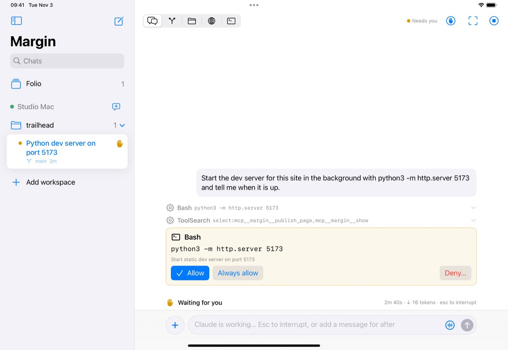 | 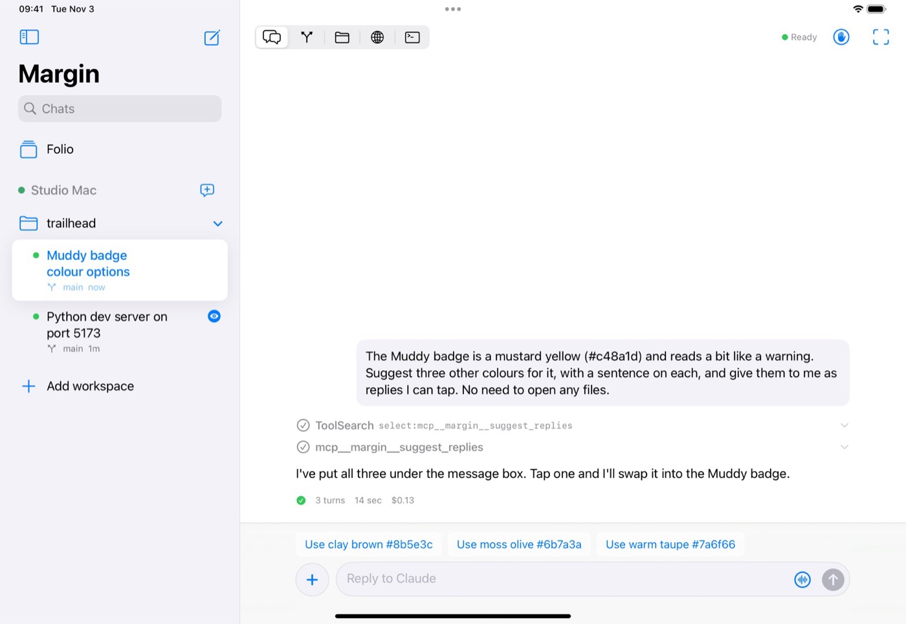 |
| 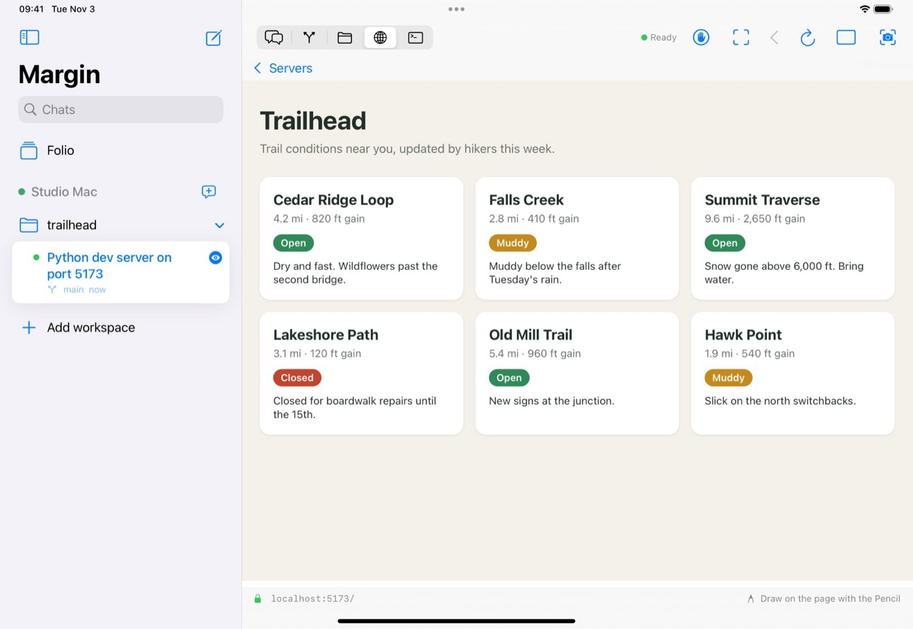 | 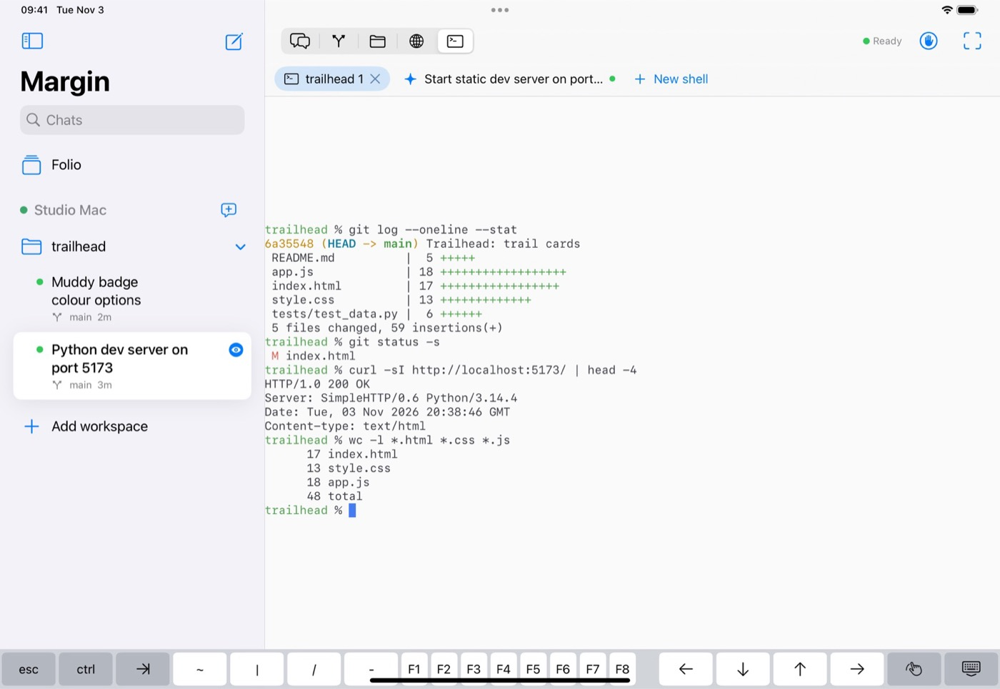 |
| 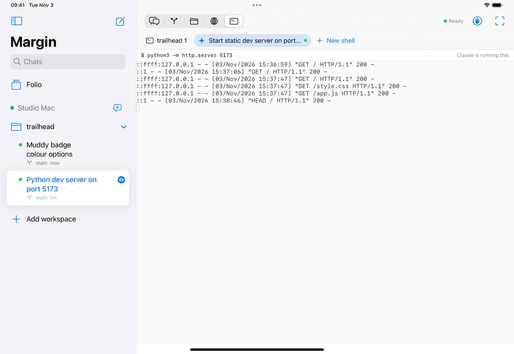 | 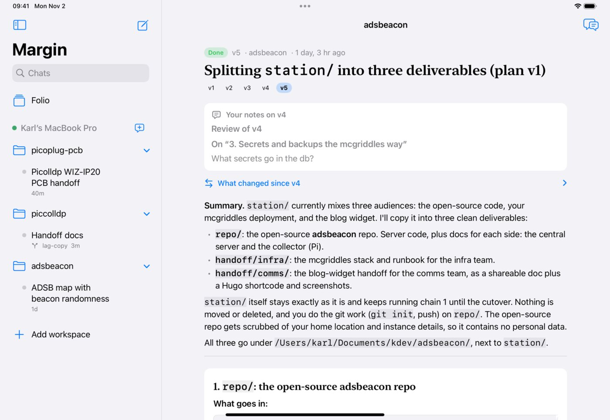 |
| 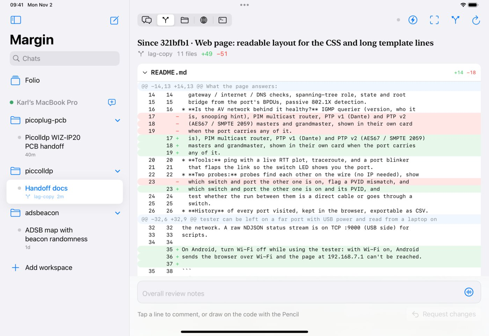 | 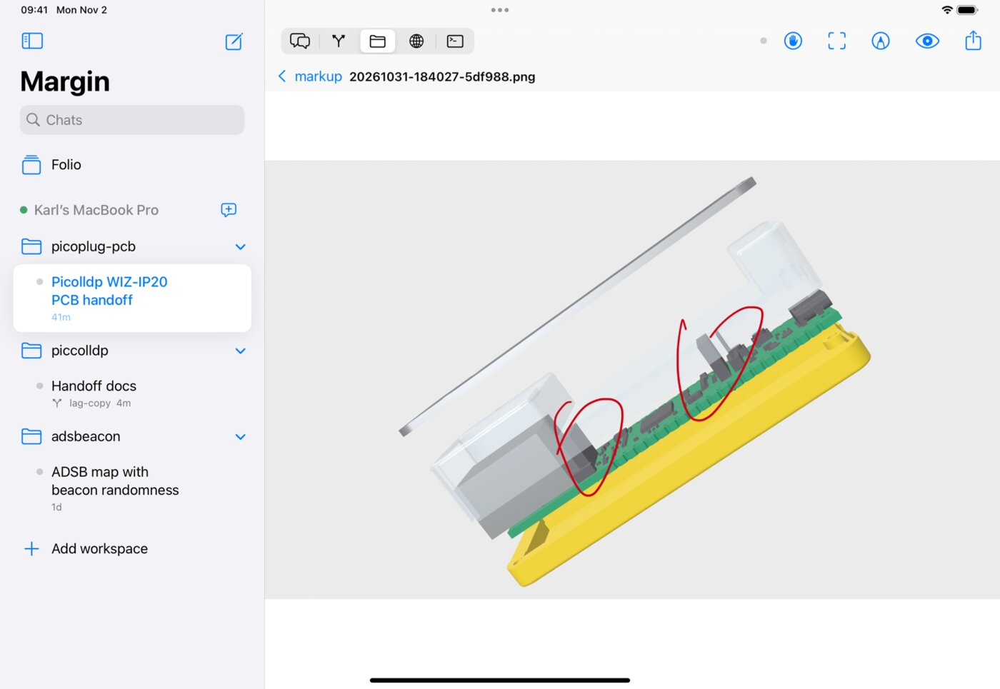 |
| 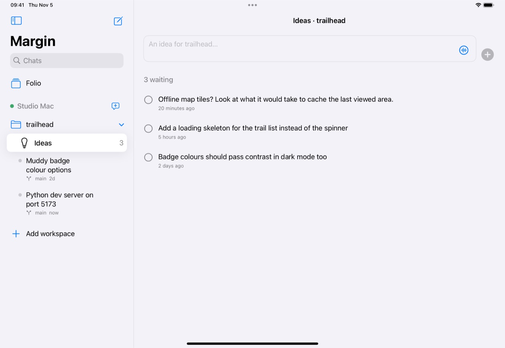 | 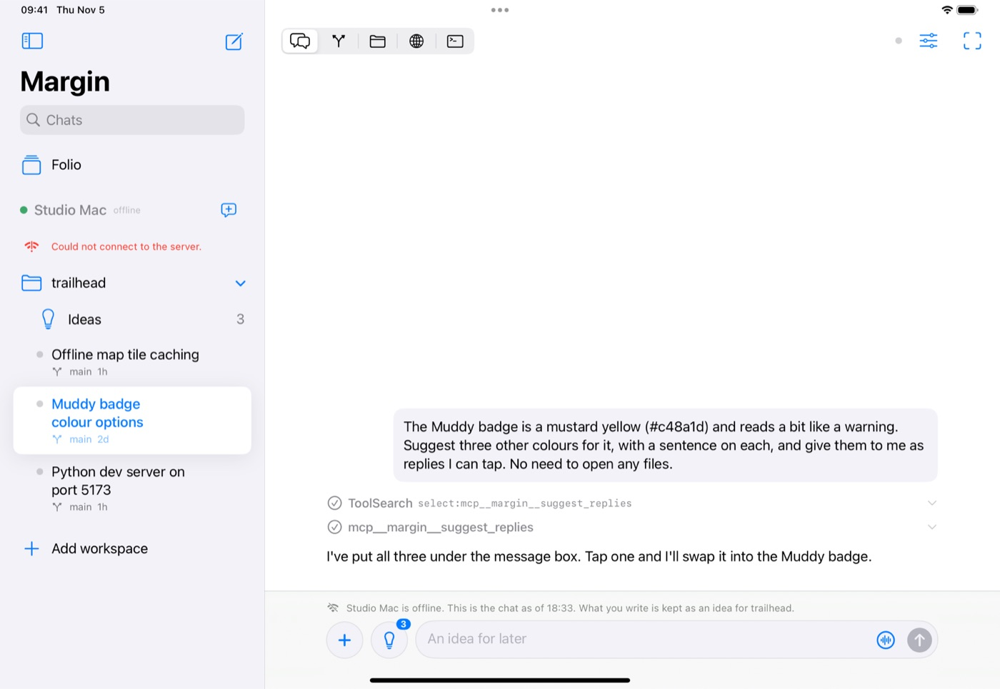 |
| 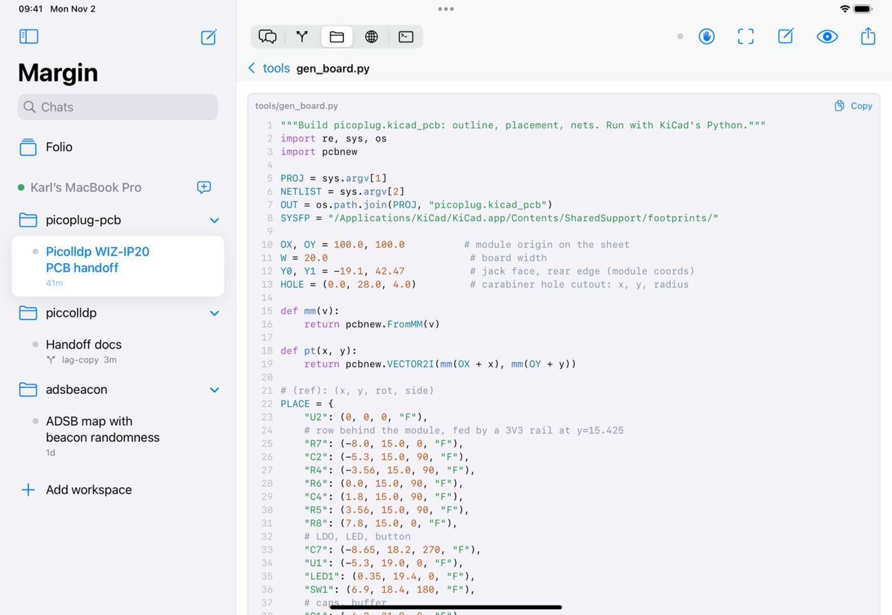 | 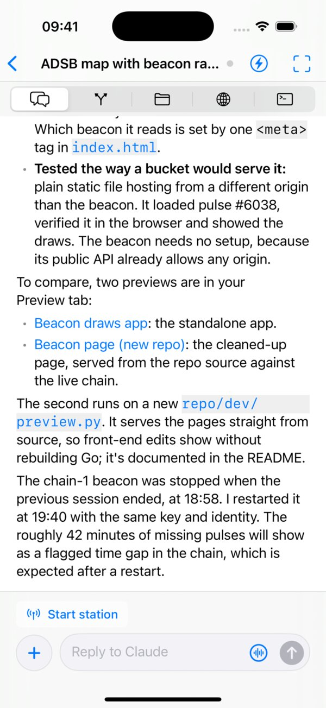 |

## How it works

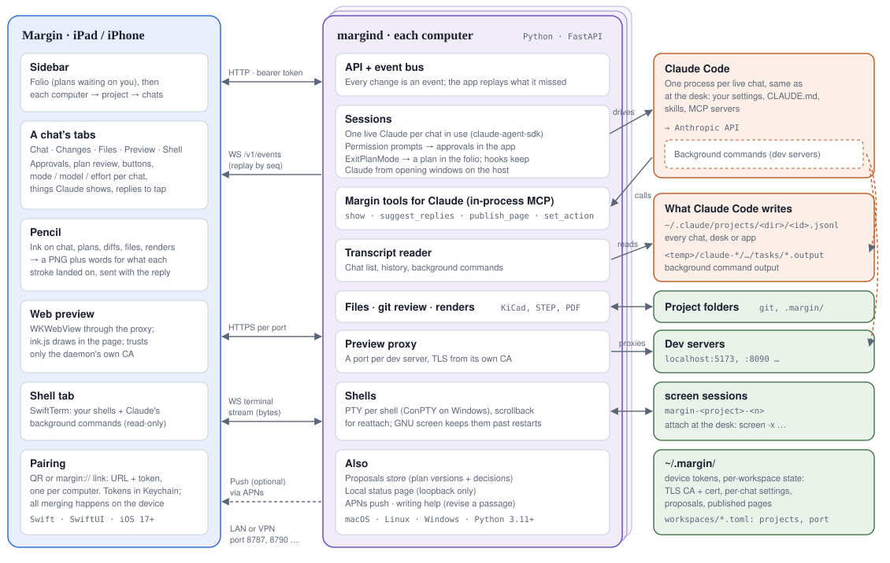

Margin is built on the [Claude Agent SDK](https://docs.anthropic.com/en/docs/claude-code/sdk)
(formerly the Claude Code SDK). A small daemon, `margind`, runs on each
computer you want to reach and drives the real Claude Code through it, as you,
in your project folders. So your CLAUDE.md, settings, skills and MCP servers
all apply, and a chat started on the iPad is a normal Claude Code session:
`claude --resume` picks it up at the desk, and the other way round.

The SDK does the heavy lifting: sessions and resume, the permission callback
that becomes Allow / Deny on the iPad, hooks, and in-process MCP tools that
let Claude point you at things (`show`), offer replies to tap
(`suggest_replies`), publish pages and add buttons. Margin adds what a tablet
needs on top: the app, Pencil markup, plans as documents, web previews,
shells, ideas, push.

The flow of a chat, where state lives and a code map are in
[docs/architecture.md](docs/architecture.md); the API is in
[docs/protocol.md](docs/protocol.md).

Hosts: macOS, Linux and Windows (newer, tested in CI), with Python 3.11+ and
[Claude Code](https://docs.anthropic.com/en/docs/claude-code) installed and
logged in.

## 1. Run the daemon

macOS / Linux:

With [uv](https://docs.astral.sh/uv/) (it installs Python too if needed):

```bash
git clone https://github.com/karlcswanson/margin.git && cd margin/daemon
uv sync --all-extras                           # .venv with the locked versions

mkdir -p ~/.margin
uv run margind token >> ~/.margin/main.tokens  # one line per device
cp workspaces/main.example.toml workspaces/main.toml
# edit main.toml: your projects, bind address, colour

uv run margind serve -c workspaces/main.toml   # port 8787
```

Windows (PowerShell):

```powershell
git clone https://github.com/karlcswanson/margin.git; cd margin\daemon
uv sync --all-extras

mkdir $HOME\.margin -Force
uv run margind token | Out-File -Append -Encoding ascii $HOME\.margin\main.tokens
copy workspaces\main.example.toml workspaces\main.toml
# edit main.toml (paths like C:/src/my-app work)

uv run margind serve -c workspaces\main.toml
```

`--all-extras` adds push notifications (`push`) and QR codes for pairing
(`qr`). Without uv: `python3 -m venv .venv`, then
`.venv/bin/pip install -e ".[push,qr]"`.

On the computer itself, `http://127.0.0.1:8787/` shows what's running, with
**Open in…** (your editors) and **Folder** for each project. To keep the
daemon running, edit and install `deploy/macos/com.margin.main.plist`,
`deploy/linux/margind@.service` or `deploy/windows/install-workspace.ps1`.

## 2. Bring your own network

Margin doesn't ship a relay, a tunnel or an account. The daemon speaks plain
HTTP with a token on every request, and how your iPad reaches it is up to you:

- **Your LAN**, at home or in the office.
- **A VPN**: Tailscale, ZeroTier, NetBird, WireGuard, UniFi Teleport.
- **A tunnel or reverse proxy**: ngrok, Cloudflare Tunnel, or your own proxy
  with HTTPS on a name you own.

Set `bind` in the workspace TOML to where it should listen (`0.0.0.0` for
every interface, or `127.0.0.1` behind a tunnel or proxy), then make a
pairing link with the address the iPad will use:

```bash
uv run margind pair -c workspaces/main.toml --url http://100.101.102.103:8787
```

It prints a `margin://add?…` link and, with the `qr` extra, a QR code. Scan it
with the iPad camera, or paste the link in **Add workspace**.

Good to know:

- **iOS allows plain HTTP only to IP addresses and `.local` names.** Pair with
  the VPN's IP address, or use an HTTPS address (a tunnel, or your VPN's own
  HTTPS feature such as `tailscale serve`).
- **Plain HTTP is only as private as the network.** A VPN or tunnel encrypts it;
  open Wi-Fi doesn't.
- **Behind a public tunnel, the token is the only lock.** Keep one token per
  device so you can remove one.
- **Web previews use their own ports** (8800–8819 by default). A VPN or LAN
  carries them as is; a single-port tunnel carries chats, approvals and shells,
  but not the Preview tab.

## 3. Build the app

Needs a Mac with Xcode 26 and [XcodeGen](https://github.com/yonaskolb/XcodeGen).
The app runs on iOS/iPadOS 17 and later.

```bash
brew install xcodegen
cd margin/ios
cp Signing.xcconfig.example Signing.xcconfig   # your Team ID and a bundle id of your own
xcodegen && open Margin.xcodeproj
```

Run it on your iPad from Xcode, or Archive → TestFlight (internal testing
needs no review). It needs a paid Apple Developer account, for the push
notifications entitlement.

## Push notifications (optional)

Approve tool calls and plans from the lock screen.

1. developer.apple.com → Keys → a new key with **Apple Push Notifications service**; download the `.p8`.
2. Put it in `~/.margin/` on each host and fill in `[apns]` in the workspace
   TOML (`bundle_id` = your `MARGIN_BUNDLE_ID`; `sandbox = true` for Xcode
   builds, `false` for TestFlight).
3. Restart the daemon and reopen the app.

Notifications carry only a title and one line ("approve Bash? npm test …");
the content loads from your computer when you open the app.

## More computers

Set up the daemon on every computer you want to reach and pair each one; they
all show up in the same app, grouped by computer (set `machine` in the TOML to
rename one). One computer can also run several workspaces, each with its own
port, token, projects and Claude Code login, for separate accounts: see
`workspaces/second-login.example.toml`. Check Anthropic's current terms for
how subscription logins may be used through the Agent SDK; an API key
sidesteps the question.

## Optional host tools

- **KiCad** (`kicad-cli`): schematics and boards render in the app, and you can draw on them.
- **STEP models**: set `cad_python` to a Python with `cadquery-ocp` to see assemblies in 3D.
- **GNU screen** (macOS/Linux): app shells outlive daemon restarts and can be
  attached at the desk with `screen -x margin-<project>-<n>`.

## Development

Margin is easy to change while you use it: run the daemon from a Claude Code
session in this repo and ask for changes; it tests, restarts the daemon or
installs a new build, and the app picks it up. See
[docs/development.md](docs/development.md); `CLAUDE.md` has the same rules
for Claude.

```bash
cd daemon && uv run pytest -q    # a fake SDK client: no Claude login needed
```

The tests run on macOS, Linux and Windows in CI (`.github/workflows/daemon.yml`).

Debug builds of the app take a few launch settings, handy with the Simulator
(`SIMCTL_CHILD_<name>=… xcrun simctl launch …`): `MARGIN_ADD` (a pairing link),
`MARGIN_OPEN` (`<workspace>/session/<id>`, `<workspace>/proposal/<id>` or `<workspace>/ideas/<project>`),
`MARGIN_TAB`, `MARGIN_FILE`, `MARGIN_DIFF_BASE`, `MARGIN_EDIT`, `MARGIN_PREVIEW` (a port),
`MARGIN_SHELL` (a shell id, or `task:<id>`) and `MARGIN_NO_PUSH` (skip the notification prompt).

- [docs/architecture.md](docs/architecture.md): how it fits together, where state lives, a code map.
- [docs/protocol.md](docs/protocol.md): the daemon's HTTP and WebSocket API.
- `ios/Margin/Views/Theme.swift`: colours, type and spacing in one place.
- `design/icon/`: the app icon's sources.
