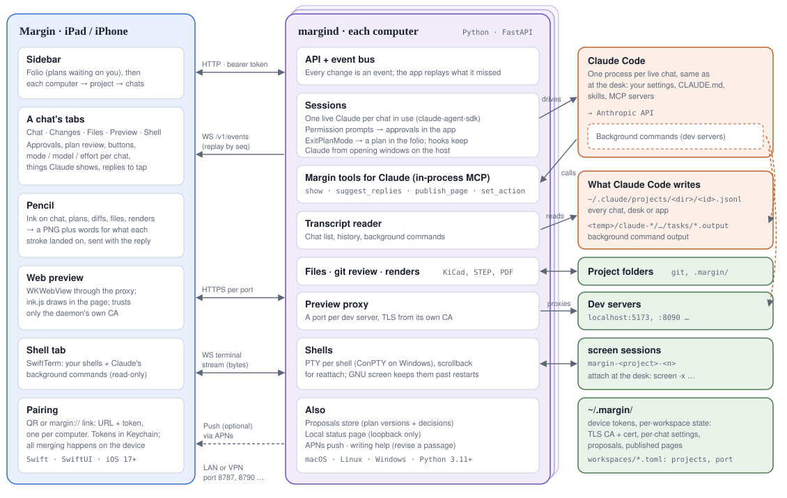

# How Margin works

- **`margind`** is a small Python daemon on each computer you want to reach,
  with its own projects and token. It runs Claude Code through the
  [Claude Agent SDK](https://docs.anthropic.com/en/docs/claude-code/sdk), as
  you, in your project folders, and serves the app over HTTP and a WebSocket.
- **Margin** is a SwiftUI app. It talks to every computer you've added and
  shows their projects and chats side by side, merged on the device only; the
  computers never talk to each other.

## A chat, end to end

1. You type or speak in a chat. The app posts it; the daemon hands it to that
   chat's Claude Code process, starting one with `resume` if the chat was idle.
   The app shows *Sending*, then *Starting Claude Code*, then *Thinking*.
2. Claude works as it would at the desk. The daemon reads its output
   continuously and turns each message into an event on the WebSocket. Every
   event has a sequence number, so after a dropped connection or a daemon
   restart the app catches up on what it missed.
3. When Claude needs permission, the SDK's `can_use_tool` callback holds the
   tool call and the app gets an approval (and a push, if set up). Plans
   (`ExitPlanMode`) arrive in the folio to mark up, then approve or send back.
4. Pencil marks are saved as PNGs in the project's `.margin/markup/`, with a
   sentence for each stroke saying what it landed on, and go with your reply
   for Claude to read.

## Claude Code's, used as is

- **The agent:** the real Claude Code with your settings, CLAUDE.md, skills and
  MCP servers.
- **Chats:** its transcripts are the source of truth, so the desk and the app
  see the same chats.
- **Background commands** (dev servers, watchers): read from its transcript
  and output files and shown in the Shell tab. They end with the Claude
  process, as at the desk.
- **Modes, models and effort:** its own, set per chat.

## What Margin adds

- **Reaching the computer:** token auth, event replay, pairing links and QR codes.
- **Seeing work:** a preview proxy with HTTPS and in-page ink, file renders
  (PDF, images, KiCad, STEP), git review since any commit.
- **Hands on the computer:** real shells, kept alive in GNU screen where it exists.
- **Tools for Claude**, an in-process MCP server through the SDK: `show` points
  you at a file, line or diff; `suggest_replies` offers replies to tap;
  `publish_page` adds a page to the Preview tab; `set_action` adds a button for
  a command. None of them take focus.
- **Hooks**, through the SDK, that keep Claude from opening windows on the host
  and remind it you're reading on a tablet.
- **Ideas and offline reading:** notes per project, and a copy of recent chats
  on the device.

## Where state lives

| | |
|---|---|
| Claude Code's own files | chats and background command output; Margin never writes them |
| `~/.margin/` | device tokens; per workspace: its TLS CA, per-chat settings, plan versions with decisions, published pages, registered devices |
| `.margin/` in a project | markup images, buttons, ideas (git-excluded) |
| On the device | paired computers (tokens in the Keychain), sidebar order, view settings; per computer, a copy of the chat list, the chats opened last, plans and ideas for reading offline (unreadable while locked, not backed up) |

## Code map

| | |
|---|---|
| `daemon/margind/server.py` | FastAPI app: HTTP routes, the events and terminal WebSockets, auth |
| `sessions.py` | live Claude Code sessions: the reader, approvals, hooks, Margin's tools, history |
| `normalize.py` | SDK messages and transcript lines into the one JSON shape the app renders |
| `events.py` | the event bus: sequence numbers, replay buffer, boot id |
| `proposals.py`, `scope.py` | plans and their versions; which commands an approved plan may run without asking |
| `bgtasks.py` | Claude Code's background commands |
| `terminals.py` | shells: pty + GNU screen on macOS/Linux, ConPTY on Windows |
| `preview.py`, `tls.py` | dev servers, the HTTPS proxy per port, the daemon's own CA |
| `files.py`, `gitreview.py`, `render.py`, `step.py` | project files, git diffs, KiCad renders, STEP to 3D |
| `push.py`, `writing.py`, `localpage.py`, `desk.py` | APNs, "revise this passage", the local page and its Open in… menu |
| `ideas.py`, `actions.py` | a project's ideas and Claude's buttons, in `.margin/` |
| `ios/Margin/Model/` | `AppModel` (all computers), `WorkspaceState` (one computer's live state), `Offline` (the device copy and ideas waiting to sync) |
| `ios/Margin/Networking/` | `HostAPI`: the HTTP and WebSocket client for one daemon |
| `ios/Margin/Views/` | sidebar, chat, plans, Pencil, code, shell, web preview, `Theme` |

The HTTP and WebSocket API is in [protocol.md](protocol.md).
